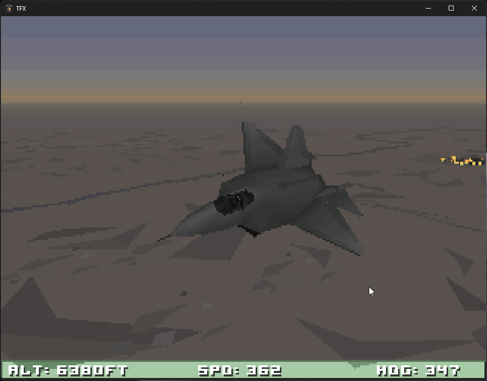

# TFX Enhanced

A native Windows version of **TFX** (*Tactical Fighter Experiment*), Digital
Image Design's DOS flight simulator, published by Ocean Software. It runs the
game directly on Windows, with no DOS emulator, from your own copy of the
game, and adds a few things the original never had.

> TFX Enhanced contains **no part of the game**: no files, pictures, sounds,
> music, missions or data of the original. You need your own installed copy
> of TFX. TFX and its content belong to their owners; this project is not
> affiliated with or endorsed by Digital Image Design, Ocean Software or
> their successors.

## Download

Get `tfx.exe` from the [latest release](../../releases/latest). It is a
single 64-bit program for Windows 10 and 11; nothing to install.

## Playing through a launcher

Two launchers can install TFX Enhanced and start it with your game folder.
Neither contains or downloads the game: you need your own installed TFX
either way.

- **[RecompLauncher](https://recomplauncher.com)**: install TFX Enhanced
  there (it takes the latest release), pick your game folder once and press
  Play. The folder is your installed TFX 2.0 (Ocean's CD edition), the one
  that holds `TFX.DAT` and `DID.DAT`; Play starts `tfx.exe --game <folder>`.
  Full screen, scaling and Enhanced 3D are settings on the game's page.
  Pilots and settings are in `SAVE\` beside the program, and the page opens
  that folder. On a Mac (the macOS zip of 26 November 2026 or later) Play
  starts `TFX.app` the same way; there the pilots and settings are in
  `~/Library/Application Support/TFX/Game`.
- **[sp00nznet's recomp-launcher](https://github.com/sp00nznet/recomp-launcher)**
  (Windows): from the next tagged version on, the release carries
  `TFX-Enhanced-Installer-windows-x64.exe`. It finds or asks for your game
  folder, downloads this project's latest Windows release and shows a Play
  button. Until then, `launcher\setup.ps1 -Game "<folder>"`, run by hand
  from a copy of this repository, does the same and leaves
  `TFX (recomp).cmd` in the repository's root.

## Enhanced 3D on the fly

Ctrl+Shift+G switches between the original 320 × 200 3D and the enhanced 3D
drawn at the window's resolution, while the game runs:



## What it does

- **Runs the original game natively.** The game's own logic, flight models,
  missions and pictures, frame for frame as under DOS, at the original
  320 × 200 shown at the 4:3 shape of a VGA monitor (or integer, stretched or
  square pixels), windowed or fullscreen (Alt+Enter).
- **Enhanced 3D** (Ctrl+Shift+G): the 3D world drawn at your window's
  resolution instead of 320 × 200; cockpit, HUD and screens stay original.
- **Settings in the game** (Ctrl+Shift+C): the setup program's choices
  (controls, detail, model, sound and music devices, joystick calibration)
  in a native window, without leaving the game.
- **Sound without DOS**: the AdLib / Sound Blaster FM music synthesized, the
  Sound Blaster and UltraSound effects mixed, the Roland (MT-32 / SCC-1)
  music sent to any Windows MIDI device, and the CD's music tracks played
  from your CD image.
- **Self-contained**: on the first start it packs the game's files it needs
  into `GAME\TFX.ZIP` and converts your CD image into `GAME\TFX.CHD` (a
  standard MAME CHD) beside the program, then runs from those. Saves stay in
  `SAVE` beside the program (or in `%LOCALAPPDATA%\TFX` when that folder
  cannot be written). Your original files are only ever read.
- Keyboard, mouse and joystick; light and dark Windows modes; an About box
  in the window menu.

See the **[user guide](docs/USER_GUIDE.md)** for the first start, the keys,
the settings and every command-line option.

## What you need

- Windows 10 or 11, 64-bit.
- Your installed TFX, version 2.0 (the CD edition, patched): its folder
  holds `TFX.DAT`, `DID.DAT` and `START.EXE`. The program checks the folder
  and tells you exactly what is missing or different.
- Optional: the TFX CD as a CUE/BIN image, for the CD music.

## This repository

The source published here is the project's own code around the game:

| Path | What it is |
| --- | --- |
| `src/win/` | the Windows program: window, input, sound output, settings view, the GAME / SAVE folders, light and dark mode, About |
| `src/host/` | portable host code: deflate / zip, FLAC, CHD v5 for CDs, SHA-1 / SHA-256, CUE/BIN reading, presentation, scan codes, the sound mixer, the settings and user-file rules, the content check |
| `src/audio/opl2.*` | an OPL2 (YM3812) FM synthesizer |
| `include/tfx/core.h` | the interface between the host and the game core |
| `mac/` | the macOS host |
| `tests/test_pack.c` | tests of the file formats (deflate, FLAC, zip, CHD) |
| `recomplauncher.json` | what RecompLauncher reads: the game folder to pick, how Play starts the program, the settings, the saves folder; a copy is in every release archive |
| `launcher/` | `launcher.json` and `setup.ps1` for sp00nznet's recomp-launcher: the setup downloads the latest Windows release and writes `TFX (recomp).cmd` |
| `.github/workflows/installer.yml` | builds that launcher's installer; a `v*` tag attaches it to the tag's release |

The game core itself, a translation of the original program, is **not**
published, so the full program does not build from this repository; the
portable formats and their test do:

```
cmake -S . -B build
cmake --build build
ctest --test-dir build
```

## Licence

The project's own code is under the [MIT licence](LICENSE). TFX, its program
and its data belong to their owners and are not part of this software.

Made by Onur BUYUKCAGLAR, with Anthropic Claude AI assistance.

<a href="https://recomplauncher.com"><picture><source media="(prefers-color-scheme: dark)" srcset="https://recomplauncher.com/assets/press/launcher/badge-light.svg"></picture></a> [](https://recompstore.com/dev/buyukcaglar)
